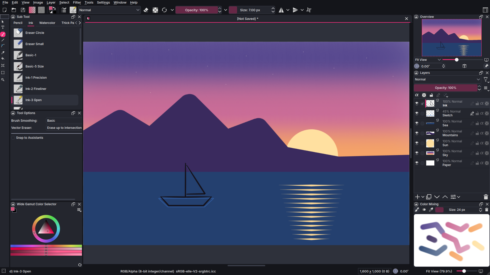
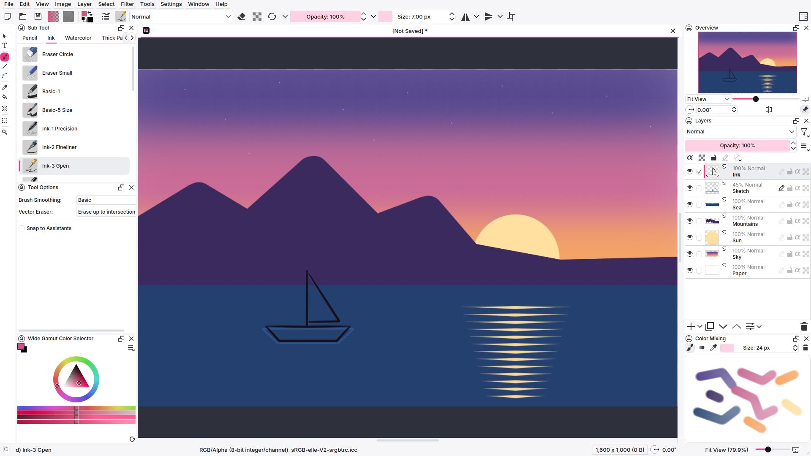
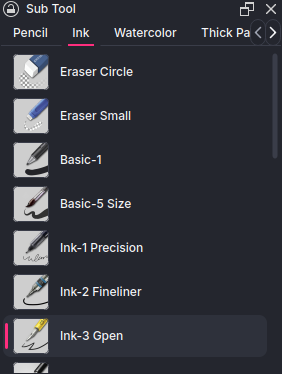
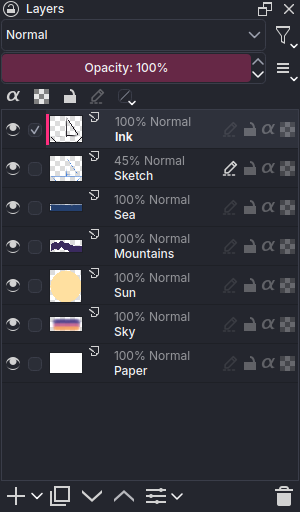
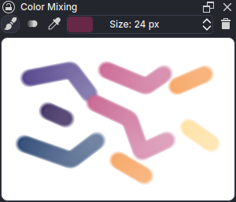
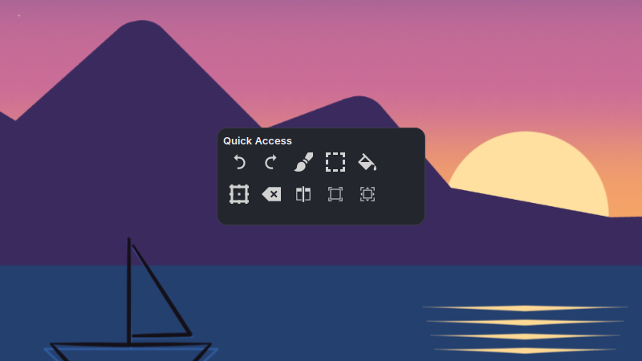
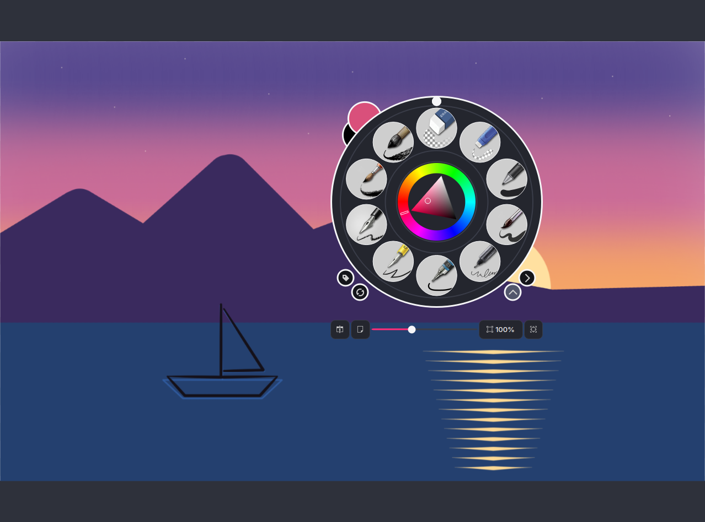
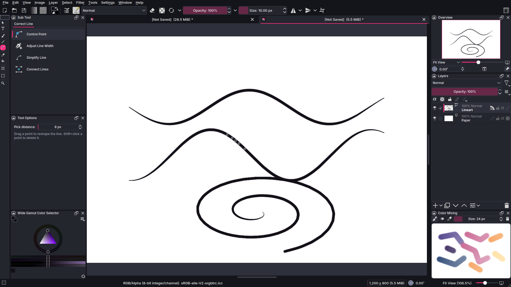

# Koma Paint

Koma Paint is a free digital painting and comic studio. Its workspace is built around how illustrators work: tools and their variants on the left, layers and navigation on the right, and the canvas in the middle with nothing in the way.



Koma Paint is based on [Krita](https://krita.org) and keeps its painting engine, brushes, filters and file format. What changes is the workspace, the controls and a set of tools for illustration and comics. Koma Paint is not affiliated with or endorsed by the Krita Foundation.

Development used AI coding assistants; the app itself contains no generative AI features. Its only MCP support is an opt-in developer plugin for automated testing, off by default.

**Contents:** [Why make this?](#why-make-this) · [The workspace](#the-workspace) · [Features](#features) · [Vector lineart](#vector-lineart) · [Working with Krita](#working-with-krita) · [Status](#status) · [Building](#building) · [Testing and debugging with MCP](#testing-and-debugging-with-mcp) · [Licence](#licence)

## Why make this?

I love drawing in Clip Studio Paint, but there aren't any applications on Linux with similar features like vector lineart. So I'm building my own alternative with similar features, and making it open source so that not just me but everyone else can benefit from it.

Clip Studio Paint is a trademark Celsys, I am not associated with the company in any way and all rights for their software are reserved to them.

## The workspace

The **Koma Studio** workspace has four areas:

| Area | What it holds |
| --- | --- |
| **Tool strip** (far left) | One button per tool group: brush, figure, fill, selection, text, ruler, eyedropper, view and operation. Each button returns to the last tool you used in that group. |
| **Left panel** | The Sub Tool panel, the tool's properties, and a colour wheel. |
| **Canvas** (centre) | Your document, with nothing floating over it unless you call it up. |
| **Right panel** | The navigator, the layers and a colour mixing palette. |

Koma Paint has dark and light themes. Both use flat panels, rounded controls and the Inter and Poppins typefaces. The pink accent is kept for what matters: the active tool, the primary action and the current selection.



## Features

### Sub Tool panel



Pick a tool on the strip, then pick a variant in the Sub Tool panel. Brush tools show their brushes in groups such as Pencil, Ink, Watercolor, Thick Paint, Gouache, Airbrush, Blend and Decoration. Each brush has a stroke preview, so you can choose by look rather than by name.

Other tools list their variants. For example, the selection tool holds rectangle, ellipse, lasso, magic wand and more.

Below the Sub Tool panel, the tool's properties show the settings that matter for that tool, such as brush smoothing or the vector eraser mode.

<br clear="right">

### Layers



Each row shows the layer's opacity and blending mode above its name. One-click toggles above the list:

- clip to the layer below;
- lock transparent pixels;
- lock the layer;
- draft layer;
- layer colour.

**Draft layers** show on the canvas but are left out when you export, so sketches, guides and notes stay out of the final image. In the screenshot, *Sketch* is a draft layer: its blue construction lines show under the ink but are left out of exported images.

**Paper.** New canvases start on a white Paper layer, with an empty layer above it to draw on.

All toggles go through the undo history, so they can be undone like any other change.

<br clear="right">

### Colour mixing



A paint surface for mixing colour by hand:

- **Brush** dabs the foreground colour with a soft round brush that picks up the paint it passes over, like a wet brush.
- **Blend** smudges neighbouring colours together.
- **Pick** takes a mixed colour as the foreground colour. Ctrl+click picks in any mode.

The mixing palette is kept between sessions.

<br clear="right">

### Quick Access and the pop-up palette

Press **Shift+Q** to open your own palette of tools, brushes, colours and commands at the cursor. Items run, switch tool, select a brush or set a colour when clicked. You can add items from the current tool, brush or colour or from a searchable command list, drag them to reorder, and remove them from the context menu. The same set is also available as a panel.



The **pop-up palette** opens under the pen or a right click. Its brush ring follows the group chosen in the Sub Tool panel, so the brushes you were just choosing from are the ones around the colour wheel.



### Canvas controls

| Action | Control |
| --- | --- |
| Pan | Space + drag |
| Zoom smoothly | Ctrl + Space + drag |
| Rotate | Shift + Space + drag |
| Resize the brush | Ctrl + Alt + drag |
| Quick Access | Shift + Q |

The default keyboard shortcuts follow Clip Studio Paint.

## Vector lineart

On a vector layer, a brush tool draws editable ink lines instead of pixels. Each line is rendered with the brush it was drawn with (pencil grain, textures and tapers) and keeps its pen-pressure profile, so it can be reshaped and re-rendered later.



- Brush previews update only the affected image tiles while drawing. Vector-layer repaints reuse a bounded cache of brush renders, storing sparse long strokes in tiles to reduce eviction; completed strokes request a prompt layer update. These optimizations do not change the saved vector line.
- **Vector eraser.** Eraser mode has three settings, chosen in the brush tool options:
  - erase the touched area;
  - erase up to intersection: clean up overshoots where lines cross;
  - erase whole line.
- Eraser intersections are spatially indexed and the live trail avoids expensive path simplification. Its antialiased edges may differ slightly from the previous preview; erased geometry is unchanged.
- **Correct Line.** A toolbox group whose sub tools edit lines after drawing:
  - **Control Point:** drag a point to reshape a line; Shift+click a point to delete it.
  - **Adjust Line Width:** brush over lines to thicken or narrow them.
  - **Simplify Line:** smooth lines and remove extra points.
  - **Connect Lines:** drag from one line end to another to join them.

Lineart lines are saved in `.kra` files and export to SVG as ordinary filled paths.

## Working with Krita

- **Files.** Documents are saved in Krita's `.kra` format and open in both applications. Draft layers are a Koma Paint addition; Krita keeps them as normal layers.
- **Settings and resources** are shared with Krita's locations (`kritarc` and the Krita resource folder). The first time Koma Paint starts, it switches to its own theme, workspace and controls.
- **Learning.** Koma Paint uses Krita's painting engine, so most of the [Krita manual](https://docs.krita.org/en/user_manual.html) applies. That covers brushes, layers, filters, selections and animation.

## Status

Koma Paint is in active development. The workspace, Sub Tool panel, layers, colour mixing, Quick Access and vector lineart described above are available now.

Vector lineart is arriving in steps. **Next:** pinch and redraw tools, snapping to control points, erasing across all vector layers, and converting raster lineart to vector.

## Building

Koma Paint builds the same way as Krita, with Qt 6 and KDE Frameworks 6. On Fedora:

```bash
sudo dnf builddep krita
sudo dnf install extra-cmake-modules ccache
```

Koma Paint also needs the header-only libraries [Immer](https://github.com/arximboldi/immer), [Zug](https://github.com/arximboldi/zug) and [Lager](https://github.com/arximboldi/lager). Install them to a local prefix and pass that prefix as `CMAKE_PREFIX_PATH`. Then configure and build:

```bash
cmake -S . -B ../build -G Ninja \
    -DCMAKE_BUILD_TYPE=RelWithDebInfo \
    -DCMAKE_INSTALL_PREFIX="$PWD/../install" \
    -DCMAKE_PREFIX_PATH=/path/to/deps/prefix \
    -DBUILD_WITH_QT6=ON -DALLOW_UNSTABLE=QT6 \
    -DBUILD_TESTING=OFF
ninja -C ../build install
```

To run Koma Paint from the install prefix, point the library and data paths at it:

```bash
PREFIX="$PWD/../install"
LD_LIBRARY_PATH="$PREFIX/lib64" \
XDG_DATA_DIRS="$PREFIX/share:/usr/local/share:/usr/share" \
KRITA_PLUGIN_PATH="$PREFIX/lib64/kritaplugins" \
"$PREFIX/bin/komapaint"
```

For everything else about building, see the [Krita build documentation](https://docs.krita.org/en/untranslatable_pages/building_krita.html). It applies to Koma Paint as well.

## Testing and debugging with MCP

Koma Paint ships an [MCP](https://modelcontextprotocol.io) server for automated testing and debugging. An MCP client such as Claude Code can:

- launch Koma Paint in a throwaway profile, with or without a window, or attach to a running session;
- paint with the real tools, using mouse or pen input that goes through the canvas input handling;
- open documents, edit layers and choose brushes;
- operate panels, menus and dialogs;
- take screenshots, check pixels and read the console output.

The screenshots in this README were taken with it. The repository's `.mcp.json` registers it for Claude Code. See [dev-tools/komapaint-mcp](dev-tools/komapaint-mcp/README.md) for the tools and how to connect.

## Licence

Koma Paint is free software, released under the GNU General Public License, version 3 or later, like Krita. Individual files carry their own SPDX headers, and the licence texts are in [LICENSES](LICENSES) and [COPYING](COPYING). Bundled fonts (Inter and Poppins) are under the SIL Open Font License; see `krita/data/uifonts`.

## Credits

Koma Paint stands on the work of the Krita developers and the KDE community. The full list of Krita contributors is in Help > About Koma Paint. Krita lives at [krita.org](https://krita.org) and [invent.kde.org/graphics/krita](https://invent.kde.org/graphics/krita).

If you are a Krita developer and you are seeing this message, I want to give a huge applause to you guys for doing the amazing work you are doing on Krita, ive been using it since I started making digital art in 2016 and its been a great software.
